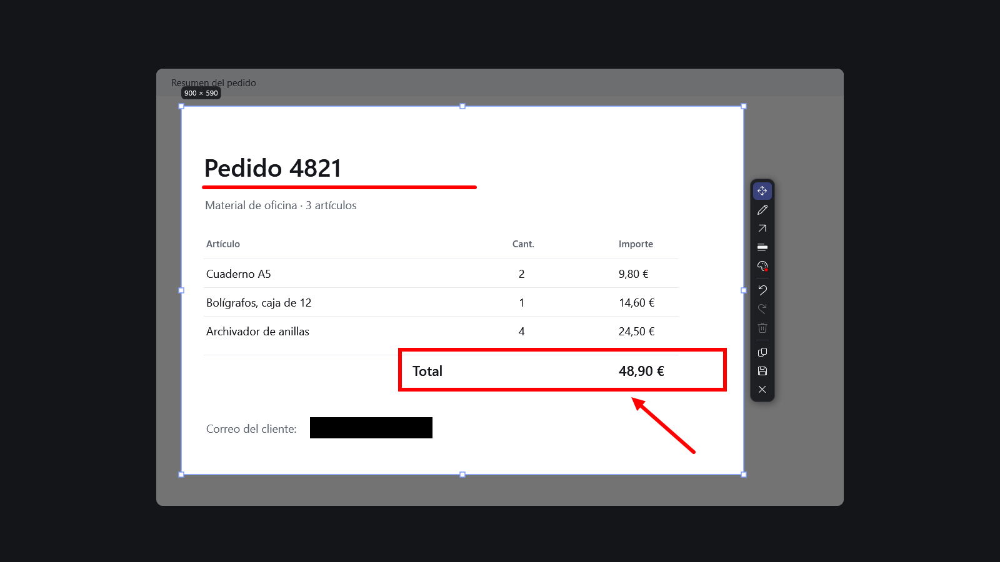

<p align="center">
  
</p>

<h1 align="center">Captio</h1>

<p align="center">
  Captura una zona de la pantalla, señálala o censúrala, y cópiala o guárdala.<br>
  Para Windows. Gratis, de código abierto y sin conexión a internet.
</p>

<p align="center">
  <a href="https://github.com/emph4sis-dev/Captio/actions/workflows/release.yml"></a>
  <a href="https://github.com/emph4sis-dev/Captio/releases/latest"></a>
  
  <a href="LICENSE"></a>
</p>

<p align="center">
  <a href="https://github.com/emph4sis-dev/Captio/releases/latest"><b>Descargar la última versión</b></a> ·
  <a href="#cómo-funciona">Ver cómo funciona</a> ·
  <a href="#compilar-desde-el-código">Compilar desde el código</a>
</p>

<p align="center">
  
</p>

## Por qué Captio

- **Captura rápida.** `ImpPant` congela la pantalla y eliges una zona al instante. Captio vive en la bandeja y casi no consume recursos mientras espera.
- **Edición directa.** Lápiz, flecha, línea, rectángulo, elipse y censura, en la misma pantalla de captura. Sin abrir otro programa.
- **Todo queda en tu equipo.** No usa red, cuentas ni nube. La censura reemplaza los píxeles por negro antes de copiar o guardar, y los PNG se guardan sin metadatos.

## Cómo funciona

1. **Captura:** pulsa `ImpPant` y arrastra para elegir una zona. Puedes moverla y redimensionarla.
2. **Edita:** marca con el lápiz o una forma en cualquiera de los 8 colores, o tapa información sensible con la censura.
3. **Termina:** `Ctrl+C` copia la imagen y `Ctrl+S` la guarda en tu carpeta de capturas de Windows. `Esc` o `Ctrl+X` cancelan sin dejar rastro.

## Funciones

| | |
|---|---|
| **Herramientas** | Seleccionar y mover, lápiz, flecha, línea, rectángulo y elipse (con `Mayús` se dibujan rectas a 45°, cuadrados y círculos), censura sólida, deshacer, rehacer y eliminar |
| **Color** | Panel compacto con 8 colores; Captio recuerda el último |
| **Barra de edición** | Arriba, abajo, a la izquierda o a la derecha de la selección, centrada respecto a ella |
| **Guardado** | En *Imágenes\Screenshots* (o la carpeta que elijas), con nombres como los de Windows: `Captura de pantalla 2026-10-30 013340.png` |
| **Biblioteca** | Es tu carpeta de capturas: filtrar por fecha, copiar, arrastrar, exportar, renombrar y borrar |
| **Opciones** | Atajo configurable, acción de `Enter`, guardar también al copiar e iniciar con Windows |

## Instalación

1. Descarga **Captio-Setup-x.y.z.exe** desde [Releases](https://github.com/emph4sis-dev/Captio/releases/latest).
2. Ábrelo. No pide permisos de administrador: se instala solo para tu usuario.
3. **Aviso de SmartScreen:** el instalador todavía no tiene firma digital, así que Windows puede mostrar «aplicación no reconocida». Pulsa *Más información → Ejecutar de todas formas*. Las versiones nuevas incluyen su archivo `.sha256` y una atestación de procedencia para verificar la descarga.

Para desinstalar: *Configuración de Windows → Aplicaciones → Captio*. Tus capturas y tu configuración se conservan.

## Atajos

| Acción | Atajo |
|---|---|
| Capturar | `ImpPant` (configurable) |
| Seleccionar · lápiz · forma · censura | `V` · `P` · `F` · `R` |
| Menú de formas · panel de color | `Mayús+F` · `C` |
| Deshacer · rehacer · eliminar anotación | `Ctrl+Z` · `Ctrl+Y` · `Supr` |
| Copiar · guardar | `Ctrl+C` · `Ctrl+S` |
| Acción predeterminada | `Enter` |
| Cancelar | `Ctrl+X` o `Esc` |

Si `ImpPant` abre la herramienta de recortes de Windows, desactiva *Configuración → Accesibilidad → Teclado → Usar la tecla Imprimir pantalla para abrir la captura de pantalla*, o elige otro atajo en Captio.

## Privacidad

- **Sin red:** Captio no hace ninguna conexión, ni siquiera para buscar actualizaciones.
- **Sin cuentas, telemetría ni nube.**
- **Censura destructiva:** los píxeles tapados se sustituyen por negro opaco en la imagen final, que no tiene capas. El original sin censurar nunca se escribe en disco.
- **PNG limpios:** solo con los datos necesarios para mostrar la imagen, sin texto, fechas ni EXIF.
- **Solo preferencias:** la configuración (`%APPDATA%\Captio\settings.json`) no guarda capturas ni datos de ellas.

## Compatibilidad

- Windows 10 (versión 1809 o posterior) y Windows 11, de 64 bits.
- No hace falta instalar .NET: el instalador lo incluye.
- Varios monitores con escalas distintas: cada monitor se captura por separado.
- Los juegos en pantalla completa exclusiva tardan en mostrar la captura porque Windows tiene que sacarlos de ese modo; con *ventana sin bordes* es inmediata.

## Compilar desde el código

Requisitos: Windows 10 u 11 y el [SDK de .NET 10](https://dotnet.microsoft.com/download/dotnet/10.0).

```bash
dotnet build
```

```bash
dotnet test
```

```bash
dotnet run --project src/Captio
```

Para generar el instalador hace falta [Inno Setup 6](https://jrsoftware.org/isinfo.php):

```bash
powershell -ExecutionPolicy Bypass -File scripts/build-installer.ps1
```

Las versiones se publican solas: al subir una etiqueta `vX.Y.Z`, el flujo [Release](.github/workflows/release.yml) ejecuta las pruebas, construye el instalador y crea la versión con su suma SHA-256.

## Arquitectura

```
src/Captio.Core   Lógica sin interfaz: anotaciones, censura, PNG, carpeta de capturas,
                  biblioteca, inicio con Windows, posición de la barra, configuración
src/Captio        Aplicación WPF: bandeja, atajo global, editor de captura y ventanas
tests/            Pruebas del núcleo y de la interfaz (aplanado, renderizado, arranque)
installer/        Instalador por usuario (Inno Setup)
docs/             Especificación (SPEC.md), sistema visual (DESIGN.md) e imágenes
```

El comportamiento completo, los casos límite y los criterios de aceptación están en [docs/SPEC.md](docs/SPEC.md).

## Hoja de ruta

- **Clips de video MP4** sin audio. Planificado; aún no disponible.
- **Firma digital del instalador**, para que SmartScreen deje de avisar.

## Contribuir

Las contribuciones son bienvenidas: lee [CONTRIBUTING.md](CONTRIBUTING.md). Para informar de una vulnerabilidad, sigue [SECURITY.md](SECURITY.md) y no abras un issue público.

## Licencia

[MIT](LICENSE).
